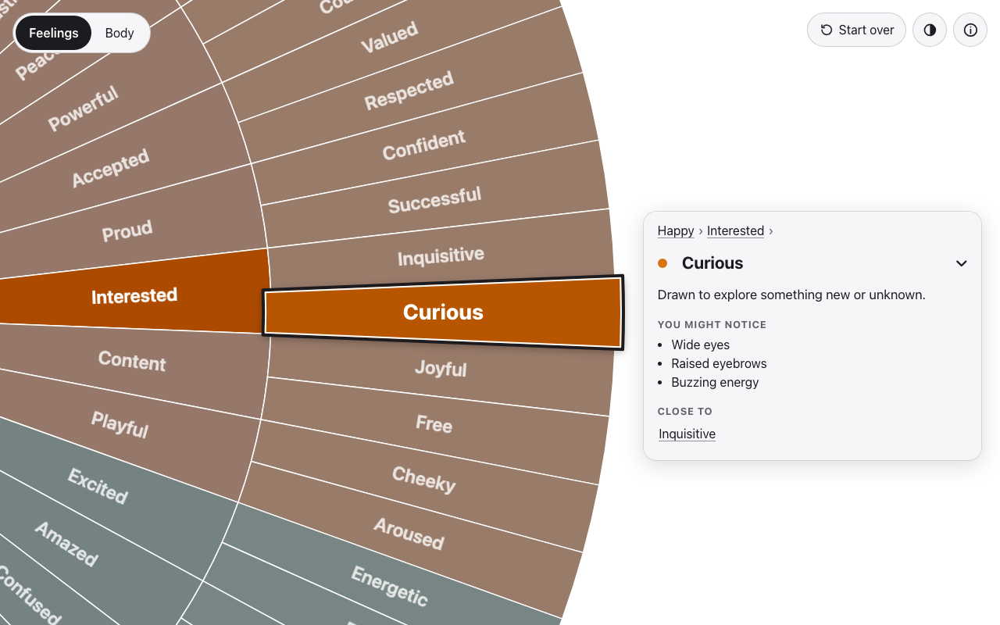

# Feels on Wheels

A free feelings wheel and body sensations wheel, to help you find the word for what you feel. Start from a few core feelings and narrow down, or start from what you notice in your body. Open a word to read what it means.

It's fast, works offline, installs as an app, works with a keyboard and screen readers, and supports light and dark mode. There are no accounts and no tracking.

**Try it: <https://lpolito.github.io/feels-on-wheels/>**



## Licence

Feels on Wheels is **source-available, not open source**. You're welcome to read, copy, change and translate it for any non-commercial purpose, as long as you give credit. Selling it, running ads on a copy, or making a paid app from it isn't allowed.

The code is under the [PolyForm Noncommercial License 1.0.0](LICENSES/PolyForm-Noncommercial-1.0.0.md). The words (everything in `src/data/`: wheel layouts, definitions, sensations, translations) and the docs are under [CC BY-NC-SA 4.0](LICENSES/CC-BY-NC-SA-4.0.txt). See [LICENSE](LICENSE).

## Running it

Needs Node.js 26.

```sh
npm ci              # install
npm run dev         # run it locally, with hot reload
npm test            # unit tests (Vitest)
npm run test:e2e    # end-to-end tests (Playwright: Chromium, Firefox, WebKit, Pixel 7, iPhone 15)
npm run build       # build to dist/
npm run size        # check the build against the size budget
```

The first `npm run test:e2e` may need `npx playwright install` for the browsers.

Changes reach `main` only through pull requests. Every pull request runs the unit tests, type-check, build, size budget and the end-to-end tests in all five browsers (`.github/workflows/ci.yml`), and all of them must pass to merge. Every push to `main` then deploys to GitHub Pages (`.github/workflows/deploy.yml`).

## Adding a language

A language is one file of words: a copy of `src/data/locales/en.json`, translated. See [CONTRIBUTING.md](CONTRIBUTING.md#languages).

## Ideas and the roadmap

What's built, what's next and what's still an idea are all in [docs/ROADMAP.md](docs/ROADMAP.md). To suggest something, [open an issue](https://github.com/lpolito/feels-on-wheels/issues).

## Credits

Feels on Wheels draws on feelings wheels by Gloria Willcox, Geoffrey Roberts and Lindsay Braman, and on feelingswheel.com. The app's About page credits each one, and [docs/reference/](docs/reference/README.md) has notes on every source.

Made by [Lucas Polito](https://lucaspolito.dev/).

## Moving to a domain

The app's public address is set in one place, `site.config.ts`. To move it to its own domain:

1. Buy the domain. Check the trademark first.
2. Set `site.url` to it (ending in `/`) and `indexable: true`, which removes the `noindex` tag.
3. Add `public/CNAME` containing the bare domain. In the repo's Pages settings, set the custom domain and turn on "Enforce HTTPS". Point the domain's DNS at GitHub Pages.
4. Update the repo's homepage: `gh repo edit --homepage https://<domain>/`.
5. Deploy, then check the preview tags with `curl` and a link-preview checker.
6. Then follow [docs/website-icon/README.md](docs/website-icon/README.md) to add the app to lucaspolito.dev.

Installs and saved themes at the old address don't carry over to the new one.
