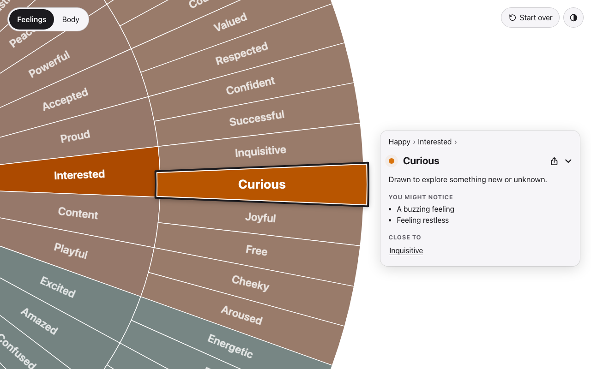

# Feels on Wheels

A free feelings wheel and body sensations wheel, to help you find the word for what you feel. Start from a few core feelings and narrow down, or start from what you notice in your body. Open a word to read what it means.

**Try it: <https://feelsonwheels.app/>**



## What went into it

It's meant to have everything you'd want from a modern web app, with accessibility and performance treated as features, not afterthoughts.

- **Accessible.** The wheel is drawn on a canvas, but every word is also in a real tree, built for a keyboard and screen readers (with some [known limitations](ACCESSIBILITY.md#known-limitations)). It follows your light or dark mode, and respects reduced motion and forced colors (high contrast). Automated accessibility checks (axe) run in the tests.
- **Fast.** Spinning stays smooth: in performance tests, 95% of frames come 20 ms apart or less, in Chromium and Firefox.
- **Small.** No frameworks and no runtime dependencies. The page itself, its HTML, CSS and scripts with every word and definition, is about 41 KB gzipped, against a 60 KB budget that every pull request checks.
- **Offline and installable.** After one visit it works with no connection. To keep it handy, install it from your browser's menu, or use Add to Home Screen on an iPhone or iPad.
- **Any screen.** Layouts are tested from 280 px phones to 2560 px monitors, in Chromium, Firefox and WebKit, and at the sizes of a Pixel 7 and an iPhone 15.
- **Private.** No accounts, no tracking, no analytics. Nothing you choose leaves your device.

## Research behind the feelings wheel

The feelings wheel starts from six core feelings in the middle and gets more specific toward the edge. Its words aren't copied from another wheel: they were chosen by a short set of rules, checked against research on how people group and use feeling words. It's for finding words, not a clinical or diagnostic tool.

### How it's built

- **Built around how people use it.** You start at the center, tap the core that matches what you feel, tap a narrower word, find your word, and read its card to check it fits. Every word sits where someone feeling it would look.
- **Six cores:** Happy, Angry, Love, Sad, Bad, and Scared, arranged like a color wheel so opposites face each other. Each is all pleasant or all unpleasant. Bad is the door for when you can't tell what you feel, and everything inside it is specific.
- **Words for what happened to you,** like Betrayed or Left out, are on the outer ring, under the feeling people would look for first. Their cards still describe a feeling.
- **A few words are in two places,** where people really split between two cores: Betrayed is under both Sad and Angry, and Empty under both Sad and Bad. Disgusted is in two places because it means two things: physical disgust under Bad, and moral disgust under Angry.
- **Words side by side are related,** so if you land one word off, the word you meant is next to it.
- **Every card is plain language,** one sentence that reads after "I feel", for anyone, including someone learning English or too upset to puzzle over a sentence.

### What the research found

- **People sort feeling words into the same few families:** love, joy, anger, sadness, and fear, with pleasant or unpleasant as the first split. This holds in several languages, and across thousands of languages pleasantness is what most decides which feelings share a word. ([Shaver and others](docs/reference/shaver-emotion-prototypes.md), [Jackson and others](docs/reference/jackson-emotion-semantics.md))
- **The families have fuzzy edges,** so a word goes where it fits best, not where it fits perfectly. ([Russell and Fehr](docs/reference/russell-fehr-fuzzy-categories.md), [Cowen and Keltner](docs/reference/cowen-keltner-emotion-categories.md))
- **Which core people would tap** comes from what people report feeling together through the day, and from which category raters pick for a word. That's why Guilty and Embarrassed are under Bad, and Grateful under Happy. ([Trampe and others](docs/reference/trampe-daily-emotions.md), [Zupan and others](docs/reference/zupan-categorising-emotion-words.md), [Algoe](docs/reference/algoe-gratitude.md))
- **Some words name what happened, not a feeling:** "feeling abandoned" says what happened, which might bring hurt, fear, or anger. And tiredness is a body state, not a feeling. ([Ortony, Clore and Foss](docs/reference/ortony-clore-foss-affective-lexicon.md))
- **Stress is an umbrella** for several feelings, so Stressed isn't on the wheel but its parts are, like Overwhelmed and Pressured. And boredom is a real emotion. ([Lazarus](docs/reference/lazarus-appraisal.md), [Danckert and others](docs/reference/danckert-boredom.md))
- **Particular words:**
  - shame, guilt, and embarrassment are different feelings, and shame doesn't always make you hide ([Tangney](docs/reference/tangney-shame-guilt.md), [Leach and Cidam](docs/reference/leach-cidam-shame.md));
  - physical and moral disgust are different ([Rozin and others](docs/reference/rozin-disgust.md));
  - compassion is warm and pity is sad ([Goetz and others](docs/reference/goetz-compassion.md));
  - being moved is its own feeling ([Zickfeld and others](docs/reference/zickfeld-kama-muta.md)).
- **The old cores came from faces,** the emotions people recognize on photographed faces, which says little about the words people use for themselves. ([Barrett and others](docs/reference/barrett-facial-expressions.md))
- **Naming a feeling eases it a little,** but no study shows that feelings wheels help, so the wheel's only claim is that it helps you find a word. ([Lieberman and others](docs/reference/lieberman-affect-labeling.md))
- **Word data** checked each choice: how pleasant a word is ([NRC VAD](docs/reference/nrc-vad-lexicon.md), [Warriner and others](docs/reference/warriner-affective-norms.md)), which meaning it usually has ([the Glasgow Norms](docs/reference/glasgow-norms.md)), which words people link ([Small World of Words](docs/reference/small-world-of-words.md)), how often people write "I feel ___" ([Google Books](docs/reference/google-books-ngram.md)), and which core words young children know ([Baron-Cohen and others](docs/reference/baron-cohen-emotion-vocabulary.md)). The data isn't in this repo, and neither are the checks that need it: they live in the [feels-on-wheels-data](https://github.com/lpolito/feels-on-wheels-data) repo and run on a computer that has the data.

### What isn't research

- **Bad as a core** is a design choice: no research list has a catch-all.
- **Lucas's calls:** which close words to use (Resentful, not Bitter), the order of the cores, and every card's wording.

The decisions and close calls are in the [design spec](docs/superpowers/specs/2026-11-26-feels-on-wheels-opinionated-wheel-design.md#6-the-record-decisions-and-close-calls).

### How it was decided

- **Lucas set the rules,** with someone starting at the center and tapping outward as the test for everything.
- **Claude did the research and drafting,** and separate AI agents that hadn't seen the reasoning checked each claim and each draft cold.
- **Lucas made the calls,** reviewed every card twice, and rewrote freely.
- **Lucas isn't a clinician or a researcher,** and doesn't claim to be.
- **The rules** that keep the wheel this way are in [src/data/README.md](src/data/README.md).

**If a word seems wrong or missing,** or you know research that says otherwise, please [open a Wheel content issue](https://github.com/lpolito/feels-on-wheels/issues/new?template=wheel-content.yml).

## Research behind the body wheel

The body sensations wheel starts from what you notice in your body and leads to the feelings that often come with it. It isn't made up on a whim: every sensation and urge on it rests on something you can check, and the few that rest on common speech or one person's experience say so. It's for finding words, not a clinical or diagnostic tool.

### How it's built

- **Places you could point to, plus Urges.** The areas run head to toe in a body scan's order (Head / face, Throat / mouth, Shoulders, Hands, Chest, Stomach), then Whole body for what you feel all over. The last area, Urges, holds what you feel pulled to do: run, hide, lash out, numb out. Many people notice the pull before they can name the feeling.
- **A sensation is something you'd notice with your eyes closed and nobody watching.** What others see, like a smile or raised eyebrows, isn't on the wheel.
- **One sensation, several feelings.** The same body signal can mean different things: a racing heart can be scared or excited, and not feeling much can be content or unmotivated. The wheel offers both readings where they're real, and offers good feelings only as the other reading of a sensation, since few people need help knowing they feel good.

### What the research found

- **Where people feel emotions.** Over 700 people painted where they felt each emotion grow or fade. Most basic emotions showed up in the upper chest; anger in the arms and hands; disgust in the throat and gut; sadness drained the limbs; happiness filled the whole body. The maps matched across cultures. ([Nummenmaa and others](docs/reference/nummenmaa-bodily-maps.md))
- **Sensing your body from inside** is called interoception, and it's what the eyes-closed test describes. ([Craig](docs/reference/craig-interoception.md))
- **What fear, anxiety, and low mood feel like** is spelled out in the standard clinical lists: a pounding heart, a tight throat, lightheadedness, feeling empty, fatigue. ([DSM-5](docs/reference/dsm-5-symptoms.md))
- **Urges are part of an emotion,** separate from its sensations: fear pulls you to escape, anger to fight, disgust to reject, guilt to make it right. ([Frijda](docs/reference/frijda-action-tendencies.md), [DBT](docs/reference/linehan-dbt-model-of-emotions.md))
- **Many urges are a way to stop feeling something,** like numbing out, and noticing the pull without acting on it is a skill taught in recovery. ([Hayes and others](docs/reference/hayes-experiential-avoidance.md), [Marlatt](docs/reference/marlatt-urge-surfing.md))
- **Particular paths:**
  - disgust is felt as nausea ([Rozin](docs/reference/rozin-disgust.md));
  - giving up follows what you can't control ([Maier and Seligman](docs/reference/maier-seligman-learned-helplessness.md));
  - people cry from frustration and being moved, not just sadness ([Vingerhoets](docs/reference/vingerhoets-crying.md));
  - rejection registers like pain ([Eisenberger and others](docs/reference/eisenberger-social-pain.md));
  - the urge to help comes with caring ([Goetz and others](docs/reference/goetz-compassion.md));
  - insecurity can pull you toward closeness ([Mikulincer and Shaver](docs/reference/mikulincer-shaver-attachment.md));
  - anger often covers hurt ([Greenberg](docs/reference/greenberg-emotion-focused-therapy.md)).
- **Calm and numb can feel alike.** Low-energy feelings can be pleasant or unpleasant ([Russell](docs/reference/russell-circumplex.md)), and calm acceptance is easily confused with numbness; whether you still care is the difference ([Desbordes and others](docs/reference/desbordes-equanimity.md)).
- **Body idioms** like butterflies or a lump in your throat often grow out of what the body really does, which is why idioms that name a real sensation are allowed. ([Kövecses](docs/reference/kovecses-emotion-metaphors.md))

### What isn't research

- **Common speech:** some words rest mainly on common speech for something people feel, such as Butterflies, Buzzing, Sinking feeling, Heavy heart, and Skin crawling.
- **Lucas's own experience:** a few also rest on Lucas's experience: Heart in throat, Weight on shoulders, Numb / empty, and Nothing much.

What backs each sensation is in the [design spec](docs/superpowers/specs/2026-11-15-feels-on-wheels-body-wheel-rework-design.md#3-the-wheel) and its [changes](docs/superpowers/specs/2026-11-15-feels-on-wheels-body-wheel-rework-changes.md). The feelings under each sensation have changed since; the current ones are in [docs/content-review.md](docs/content-review.md).

### How it was decided

- **Lucas set the frame and the rules:** places plus Urges, the eyes-closed test, and every common path on the wheel.
- **Claude did the research and drafting:** it found and summarized the research, and drafted the words and what backs each one.
- **Lucas made every call:** he reviewed every word over several rounds, rewrote and cut freely, and decided each one. AI suggestions that didn't hold up were dropped.
- **A second, separate AI review** checked each claim against its source. The [notes](docs/reference/README.md) say which sources were read in full and which only through abstracts or summaries.
- **Lucas isn't a clinician or a researcher,** and doesn't claim to be.
- **The rules** that keep the wheel this way are in [src/data/README.md](src/data/README.md).

**If a word seems wrong or missing,** or you know research that says otherwise, please [open a Wheel content issue](https://github.com/lpolito/feels-on-wheels/issues/new?template=wheel-content.yml). Corrections from therapists and researchers are especially welcome.

## Made with AI, with love

Feels on Wheels was built with AI, openly and on purpose. It's the first project Lucas has taken from idea to finished app with AI.

- **[Claude Code](https://claude.com/claude-code)**, Anthropic's AI coding assistant, wrote the code and helped weigh up how to build each piece.
- **[Superpowers](https://github.com/obra/superpowers)**, Jesse Vincent's skills plugin for Claude Code, shaped how every change was made, and was used heavily:
  - brainstorming each change into a written design;
  - turning that design into a step-by-step plan;
  - building it test first;
  - a fresh code review before anything shipped.
  
  Its visual companion showed mockups in the browser when a choice was easier to see than describe.

The ideas are Lucas's: what the app does, how it looks and how it feels to use. He made every usability and design call, and used each change before the next one was planned. The point was to see how fast, and how complete, an app can get when AI does the building and a person stays in the loop on what makes it good to use.

The whole process is in the repo. Every change's design is in [docs/superpowers/specs](docs/superpowers/specs), and every build plan is in [docs/superpowers/plans](docs/superpowers/plans).

The app itself is plain TypeScript, built with [Vite](https://vite.dev/). It's tested with [Vitest](https://vitest.dev/) and [Playwright](https://playwright.dev/) (with [axe-core](https://github.com/dequelabs/axe-core) for accessibility), and hosted on [Cloudflare Workers](https://developers.cloudflare.com/workers/static-assets/) as static files plus a small Worker for paths with no file (`wrangler.jsonc`, `src/worker/`).

## Running it

Needs Node.js 26.

```sh
npm ci              # install
npm run dev         # run it locally, with hot reload
npm test            # unit tests (Vitest)
npm run test:e2e    # end-to-end tests (Playwright: Chromium, Firefox, WebKit, Pixel 7, iPhone 15)
npm run test:perf   # performance tests (Playwright: Chromium and Firefox)
npm run build       # build to dist/
npm run size        # check the build against the size budget
```

The first `npm run test:e2e` may need `npx playwright install` for the browsers.

Changes reach `main` only through pull requests. Every pull request runs the unit tests, type-check, build, size budget and the end-to-end tests in all five browsers (`.github/workflows/ci.yml`), and all of them must pass to merge. Cloudflare's GitHub integration then deploys every push to `main`, except pushes that only change docs, and posts a preview link on each pull request.

## Adding a language

A language is one file of words: a copy of `src/data/locales/en.json`, translated. See [CONTRIBUTING.md](CONTRIBUTING.md#languages).

## Ideas and the roadmap

What's built, what's next and what's still an idea are all in [docs/ROADMAP.md](docs/ROADMAP.md). To suggest something, [open an issue](https://github.com/lpolito/feels-on-wheels/issues).

## Credits

Everything Feels on Wheels draws on, whether or not a license asks for credit. Each name links to a note on the source, and [docs/reference/](docs/reference/README.md) has the full citations.

- **Feelings wheels:** [Gloria Willcox's Feeling Wheel](docs/reference/core-feelings-wheel.md) (1982), [Geoffrey Roberts's Feel Wheel](docs/reference/core-feelings-wheel.md) (2015, where the first version's words came from), [Lindsay Braman's Emotion-Sensation Wheel](docs/reference/braman-emotion-sensation-wheel.md) (2020), and [feelingswheel.com](docs/reference/core-feelings-wheel.md#the-reference-site), whose tap-to-trace idea inspired this one.
- **Research behind the feelings wheel** ([what the research found](#research-behind-the-feelings-wheel)):
  - [Shaver and others](docs/reference/shaver-emotion-prototypes.md)
  - [Russell and Fehr](docs/reference/russell-fehr-fuzzy-categories.md)
  - [Cowen and Keltner](docs/reference/cowen-keltner-emotion-categories.md)
  - [Jackson and others](docs/reference/jackson-emotion-semantics.md)
  - [Ortony, Clore and Foss](docs/reference/ortony-clore-foss-affective-lexicon.md)
  - [Richard Lazarus](docs/reference/lazarus-appraisal.md)
  - [Danckert and others](docs/reference/danckert-boredom.md)
  - [June Tangney and others](docs/reference/tangney-shame-guilt.md)
  - [Leach and Cidam](docs/reference/leach-cidam-shame.md)
  - [Zickfeld and others](docs/reference/zickfeld-kama-muta.md)
  - [Fontaine and others](docs/reference/fontaine-emotion-dimensions.md)
  - [Barrett and others](docs/reference/barrett-facial-expressions.md)
  - [Trampe, Quoidbach and Taquet](docs/reference/trampe-daily-emotions.md)
  - [Zupan, Dempsey and Hartwell](docs/reference/zupan-categorising-emotion-words.md)
  - [Sara Algoe](docs/reference/algoe-gratitude.md)
  - [Nook and others](docs/reference/nook-emotion-definitions.md)
  - [Lieberman and others](docs/reference/lieberman-affect-labeling.md)
  - [Rozin and others](docs/reference/rozin-disgust.md)
  - [Goetz and others](docs/reference/goetz-compassion.md)
- **Word data used to check the feelings wheel's words:** [NRC VAD Lexicon](docs/reference/nrc-vad-lexicon.md) (Saif M. Mohammad), [Warriner, Kuperman and Brysbaert](docs/reference/warriner-affective-norms.md), [the Glasgow Norms](docs/reference/glasgow-norms.md), [Baron-Cohen and others](docs/reference/baron-cohen-emotion-vocabulary.md), [Small World of Words](docs/reference/small-world-of-words.md), and [Google Books Ngram](docs/reference/google-books-ngram.md).
- **Research behind the body wheel** ([what the research found](#research-behind-the-body-wheel)):
  - [Nummenmaa and others](docs/reference/nummenmaa-bodily-maps.md)
  - [A. D. Craig](docs/reference/craig-interoception.md)
  - [Nico Frijda](docs/reference/frijda-action-tendencies.md)
  - [Marsha Linehan](docs/reference/linehan-dbt-model-of-emotions.md)
  - [Hayes and others](docs/reference/hayes-experiential-avoidance.md)
  - [Bowen and Marlatt](docs/reference/marlatt-urge-surfing.md)
  - [Rozin and Fallon](docs/reference/rozin-disgust.md)
  - [Zoltán Kövecses](docs/reference/kovecses-emotion-metaphors.md)
  - [the American Psychiatric Association's DSM-5](docs/reference/dsm-5-symptoms.md)
  - [Maier and Seligman](docs/reference/maier-seligman-learned-helplessness.md)
  - [Ad Vingerhoets](docs/reference/vingerhoets-crying.md)
  - [Eisenberger and others](docs/reference/eisenberger-social-pain.md)
  - [Duguid and Goncalo](docs/reference/duguid-goncalo-power-height.md)
  - [Goetz and others](docs/reference/goetz-compassion.md)
  - [Mikulincer and Shaver](docs/reference/mikulincer-shaver-attachment.md)
  - [Leslie Greenberg](docs/reference/greenberg-emotion-focused-therapy.md)
  - [James Russell](docs/reference/russell-circumplex.md)
  - [Desbordes and others](docs/reference/desbordes-equanimity.md)

The app's About page names the main ones and links here.

Made by [Lucas Polito](https://lucaspolito.dev/).

## License

Feels on Wheels is **source-available, not open source**. You're welcome to read, copy, change and translate it for any non-commercial purpose, as long as you give credit. Selling it, running ads on a copy, or making a paid app from it isn't allowed.

The code is under the [PolyForm Noncommercial License 1.0.0](LICENSES/PolyForm-Noncommercial-1.0.0.md). The words (the `.json` files in `src/data/`: wheel layouts, definitions, sensations, translations) and the docs (`docs/` and the Markdown files) are under [CC BY-NC-SA 4.0](LICENSES/CC-BY-NC-SA-4.0.txt). See [LICENSE](LICENSE).
